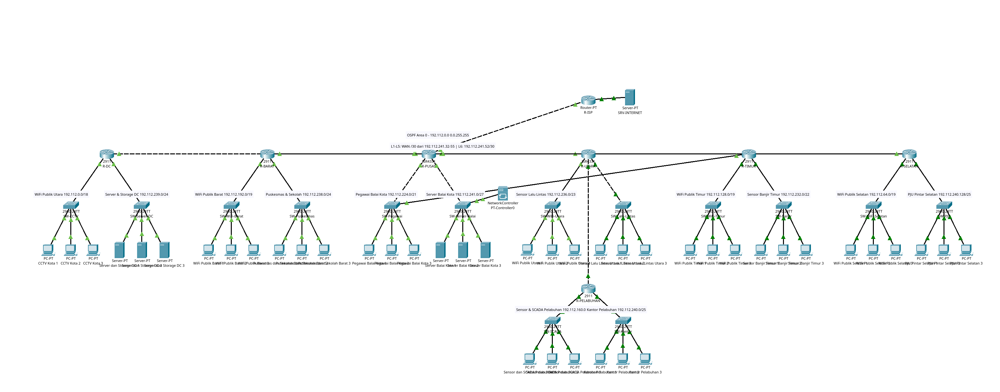
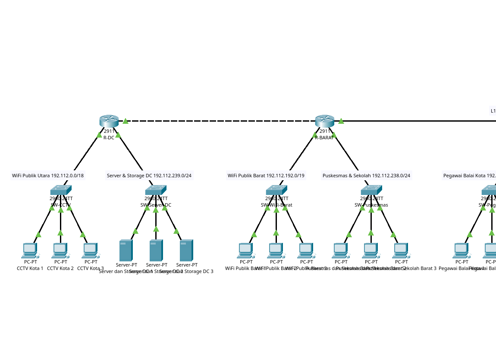
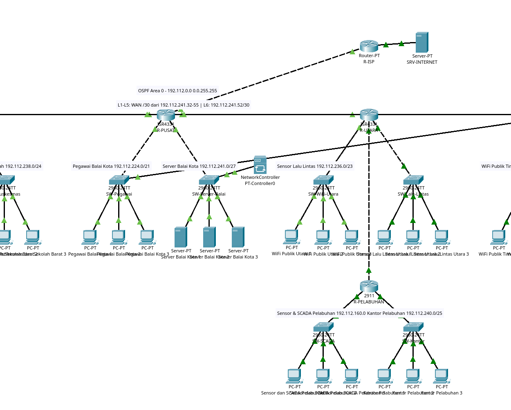
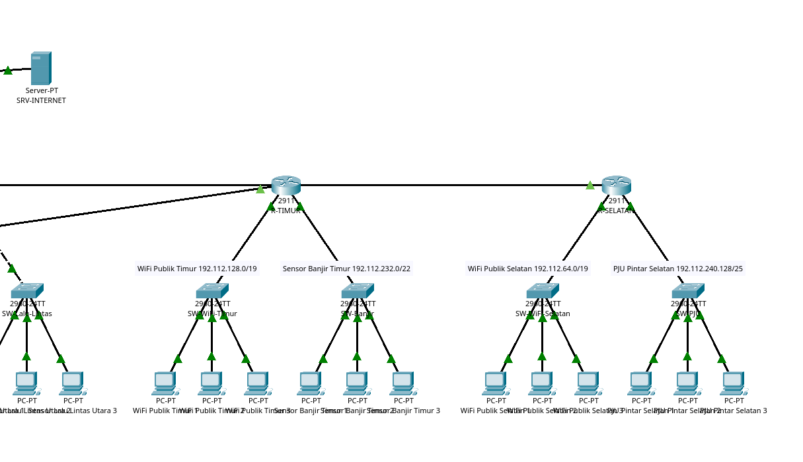

# MID PROJECT KOMUNIKASI DATA & JARINGAN KOMPUTER K14-012-066-082
### Implementasi Jaringan Smart City Pemerintah Kota Surabaya
Semester Gasal 2026/2027

---

## Anggota Kelompok 14

| No | Nama | NRP | Peran / Fokus Pengerjaan |
|:--:|:---|:---:|:---|
| 1 | Gede Satya Putra Aryanta | 5027251012 | Infrastructure, Topologi WAN, Static Routing & NAT |
| 2 | Catur Setyo Ragil | 5027251066 | Subnetting Spreadsheet, GRE Tunnel, IPsec, & Dynamic OSPF |
| 3 | Fiorellin Ilona | 5027251082 | DHCP Services, Smart City Applications (DNS, Web, FTP, Mail) & Documentation |

---

## Struktur Repositori

```text
.
├── docs/
│   ├── analisis_soal_4_dan_8.md        Analisis DHCP & layanan aplikasi
│   ├── analisis_soal_6_tunnel.md       Analisis GRE Tunnel & IPsec
│   ├── analisis_soal_7_ospf.md         Analisis OSPF & link cadangan L7
│   └── cheat_sheet_uji2_orang2.md      Panduan uji 2 individu
├── images/
│   └── soal-8/                         Screenshot topologi & detail
├── nodes/
│   ├── R-ISP/setup_isp.cfg
│   ├── R-PUSAT/                        gre_tunnel.cfg, static_nat.cfg
│   ├── R-PELABUHAN/gre_tunnel.cfg
│   ├── dhcp_all_routers.cfg            Script DHCP 7 router + relay CCTV
│   ├── ospf_all_routers.cfg            Script OSPF 7 router
│   └── router_cabang_static.cfg        Script static route router cabang
├── result/
│   ├── K14_VLSM.pkt                    Topologi utama (static + GRE + aplikasi)
│   ├── K14_VLSM_OSPF.pkt               Varian OSPF + link cadangan L7
│   └── UTS-KOMDAT-JARKOM-K14.xlsx      Spreadsheet subnetting resmi
├── K14_VLSM.pkt                        File kerja yang dibuka di Packet Tracer
├── .gitignore
└── README.md
```

---

## 1. Skema Pengalamatan

Skema yang dipakai adalah **VLSM** dengan blok induk `192.112.0.0/16`.

- Kebutuhan host seluruh kota: 61.752 alamat.
- Kapasitas blok `/16`: 65.536 alamat, efisiensi 94,23%, sisa 3.784 alamat.
- CIDR membutuhkan 118.784 alamat sehingga harus memakai blok `/15` dengan pemborosan di atas 50%.

### 1.1 Alokasi Subnet LAN (14 subnet)

| No | Router | Wilayah / Layanan | Kebutuhan Host | Network ID & Prefix | Gateway | Rentang Host | Broadcast |
|:--:|:---|:---|:---:|:---:|:---:|:---:|:---:|
| 1 | `R-UTARA` | WiFi Publik Utara | 11.000 | `192.112.0.0/18` | `192.112.0.1` | `.0.2` - `.63.254` | `192.112.63.255` |
| 2 | `R-SELATAN` | WiFi Publik Selatan | 6.500 | `192.112.64.0/19` | `192.112.64.1` | `.64.2` - `.95.254` | `192.112.95.255` |
| 3 | `R-DC` | CCTV Kota | 6.000 | `192.112.96.0/19` | `192.112.96.1` | `.96.2` - `.127.254` | `192.112.127.255` |
| 4 | `R-TIMUR` | WiFi Publik Timur | 5.500 | `192.112.128.0/19` | `192.112.128.1` | `.128.2` - `.159.254` | `192.112.159.255` |
| 5 | `R-PELABUHAN` | Sensor & SCADA Pelabuhan | 5.000 | `192.112.160.0/19` | `192.112.160.1` | `.160.2` - `.191.254` | `192.112.191.255` |
| 6 | `R-BARAT` | WiFi Publik Barat | 4.500 | `192.112.192.0/19` | `192.112.192.1` | `.192.2` - `.223.254` | `192.112.223.255` |
| 7 | `R-PUSAT` | Pegawai Balai Kota | 1.800 | `192.112.224.0/21` | `192.112.224.1` | `.224.2` - `.231.254` | `192.112.231.255` |
| 8 | `R-TIMUR` | Sensor Banjir Timur | 700 | `192.112.232.0/22` | `192.112.232.1` | `.232.2` - `.235.254` | `192.112.235.255` |
| 9 | `R-UTARA` | Sensor Lalu Lintas | 450 | `192.112.236.0/23` | `192.112.236.1` | `.236.2` - `.237.254` | `192.112.237.255` |
| 10 | `R-BARAT` | Puskesmas & Sekolah | 220 | `192.112.238.0/24` | `192.112.238.1` | `.238.2` - `.238.254` | `192.112.238.255` |
| 11 | `R-DC` | Server & Storage DC | 180 | `192.112.239.0/24` | `192.112.239.1` | `.239.2` - `.239.254` | `192.112.239.255` |
| 12 | `R-PELABUHAN` | Kantor Pelabuhan | 120 | `192.112.240.0/25` | `192.112.240.1` | `.240.2` - `.240.126` | `192.112.240.127` |
| 13 | `R-SELATAN` | PJU Pintar Selatan | 90 | `192.112.240.128/25` | `192.112.240.129` | `.240.130` - `.240.254` | `192.112.240.255` |
| 14 | `R-PUSAT` | Server Balai Kota | 20 | `192.112.241.0/27` | `192.112.241.1` | `.241.2` - `.241.30` | `192.112.241.31` |

### 1.2 Link Point-to-Point

| Link | Segmen | Subnet | Sisi A | Sisi B | Keterangan |
|:---:|:---|:---:|:---:|:---:|:---|
| `L1` | `R-PUSAT` - `R-DC` | `192.112.241.32/30` | `192.112.241.33` | `192.112.241.34` | Backbone Data Center |
| `L2` | `R-PUSAT` - `R-UTARA` | `192.112.241.36/30` | `192.112.241.37` | `192.112.241.38` | Backbone Utara |
| `L3` | `R-PUSAT` - `R-SELATAN` | `192.112.241.40/30` | `192.112.241.41` | `192.112.241.42` | Backbone Selatan |
| `L4` | `R-PUSAT` - `R-TIMUR` | `192.112.241.44/30` | `192.112.241.45` | `192.112.241.46` | Backbone Timur (via VLAN 40, `SW-Pegawai`) |
| `L5` | `R-PUSAT` - `R-BARAT` | `192.112.241.48/30` | `192.112.241.49` | `192.112.241.50` | Backbone Barat |
| `L6` | `R-UTARA` - `R-PELABUHAN` | `192.112.241.52/30` | `192.112.241.53` | `192.112.241.54` | Transit Pelabuhan |
| `L7` | `R-DC` - `R-UTARA` | `192.112.241.60/30` | `192.112.241.61` | `192.112.241.62` | Cadangan (file varian OSPF) |
| Uplink ISP | `R-PUSAT` - `R-ISP` | `203.0.113.56/30` | `203.0.113.57` | `203.0.113.58` | Akses internet |
| Internet | `R-ISP` - `SRV-INTERNET` | `8.8.8.0/24` | `8.8.8.1` | `8.8.8.8` | Simulasi internet |
| GRE Tunnel | `R-PUSAT` - `R-PELABUHAN` | `192.168.14.0/30` | `192.168.14.1` | `192.168.14.2` | Jalur privat Balai Kota - Pelabuhan |

---

## 2. Topologi Jaringan

Arsitektur hub-and-spoke dengan `R-PUSAT` sebagai core. Lima router cabang terhubung langsung
ke `R-PUSAT`, `R-PELABUHAN` terhubung melalui `R-UTARA`, dan satu GRE Tunnel menghubungkan
Balai Kota dengan Pelabuhan. Pada varian OSPF ditambahkan link cadangan L7 antara `R-DC` dan
`R-UTARA`.



---

## 3. Implementasi

### 3.1 Static Routing & NAT (Soal 3 dan 5)

- Default route hanya dipasang di router yang mengarah ke atas: cabang ke `R-PUSAT`, dan
  `R-PUSAT` ke `R-ISP` (`0.0.0.0/0` via `203.0.113.58`).
- `R-PUSAT` memiliki rute ke seluruh LAN cabang dan rute khusus Pelabuhan via Tunnel0.
- NAT overload (PAT) memakai `access-list 1` (`192.112.0.0/16` dan `192.168.14.0/30`) pada
  `GigabitEthernet0/0/2`.
- Seluruh interface internal ditandai `ip nat inside`: `Gi0/0/0`, `Gi0/0/1`, `Vlan21`,
  `Vlan27`, `Vlan30`, `Vlan40`, `Vlan50`.
- `R-ISP` tidak memiliki rute ke blok privat.

### 3.2 GRE Tunnel & IPsec (Soal 6)

- `Tunnel0`: `192.168.14.1` (R-PUSAT) dan `192.168.14.2` (R-PELABUHAN), `mtu 1476`.
- Lalu lintas Balai Kota ke Pelabuhan diarahkan lewat tunnel dengan static route.
- IPsec over GRE: ISAKMP policy 10 (AES, SHA, DH group 2, PSK `K14SECURE`), transform-set
  `esp-aes esp-sha-hmac` mode transport, crypto map pada interface WAN.
- Detail: [`docs/analisis_soal_6_tunnel.md`](docs/analisis_soal_6_tunnel.md).

### 3.3 Dynamic Routing OSPF (Soal 7)

- Single area 0, `network 192.112.0.0 0.0.255.255 area 0` pada tujuh router.
- `default-information originate` hanya di `R-PUSAT`; router lain menerima default `O*E2`.
- Seluruh adjacency yang terpasang berstatus `FULL`.
- Link cadangan L7 dan detail failover dibahas di
  [`docs/analisis_soal_7_ospf.md`](docs/analisis_soal_7_ospf.md) serta
  [`nodes/ospf_all_routers.cfg`](nodes/ospf_all_routers.cfg).

### 3.4 DHCP Services (Soal 4)

- Router dan seluruh server memakai IP statis.
- 36 PC pengguna di 12 LAN memakai DHCP dan menerima IP, gateway, serta DNS
  `192.112.239.2` secara otomatis.
- Pool per LAN pada masing-masing router; blok `.1` - `.20` di-exclude agar tidak bentrok
  dengan gateway dan perangkat statis.
- Subnet CCTV Kota dilayani DHCP server di LAN Server & Storage DC, bukan oleh router.
  R-DC hanya menjadi relay (`ip helper-address 192.112.239.2`), dengan pool `CCTV-KOTA`
  pada rentang `192.112.96.100` - `192.112.119.211`.
- Script: [`nodes/dhcp_all_routers.cfg`](nodes/dhcp_all_routers.cfg).

### 3.5 Layanan Aplikasi (Soal 8)

Domain internal `14.smartcity.lab`, dengan alias `surabaya.go.id`.

| Layanan | Server | Alamat |
|:---|:---|:---|
| DNS dan DHCP | `Server dan Storage DC 1` | `192.112.239.2` |
| FTP | `Server dan Storage DC 2` | `192.112.239.3` |
| Mail (SMTP/POP3) | `Server dan Storage DC 3` | `192.112.239.4` |
| Web | `Server Balai Kota 1` | `192.112.241.2` |

- DNS mencatat `www`, `ftp`, dan `mail` untuk `14.smartcity.lab` maupun `surabaya.go.id`.
- Web menampilkan halaman "Portal Smart City Surabaya" dengan nomor kelompok 14.
- FTP memakai akun `cctv` / `K14cctv` dan `pegawai` / `K14pegawai` dengan hak RWDNL.
- Mail memakai domain `14.smartcity.lab` dengan akun `balai1` - `balai3` dan
  `pelabuhan1` - `pelabuhan3`, diuji kirim dan terima dua arah.
- Detail: [`docs/analisis_soal_4_dan_8.md`](docs/analisis_soal_4_dan_8.md).

---

## 4. Dokumentasi Visual

Screenshot diambil langsung dari canvas Packet Tracer.

### 4.1 Wilayah Barat dan Data Center

Menampilkan `R-DC` dan `R-BARAT` beserta LAN CCTV Kota, Server & Storage DC, WiFi Publik
Barat, dan Puskesmas & Sekolah Barat.



### 4.2 Balai Kota, Utara, dan Pelabuhan

Menampilkan `R-PUSAT`, LAN Pegawai dan Server Balai Kota, `R-UTARA` dengan sensor lalu
lintas, serta `R-PELABUHAN` dengan SCADA dan Kantor Pelabuhan.



### 4.3 Timur dan Selatan

Menampilkan `R-TIMUR` dengan WiFi Publik Timur dan Sensor Banjir, serta `R-SELATAN` dengan
WiFi Publik Selatan dan PJU Pintar.



---

## 5. Bukti Pengujian

**DHCP pada klien CCTV (relay ke server DC):**

```text
IPv4 Address........: 192.112.96.100
Subnet Mask.........: 255.255.224.0
Default Gateway.....: 192.112.96.1
DHCP Server.........: 192.112.239.2
DNS Servers.........: 192.112.239.2
```

**Lease pada server DHCP DC:**

```text
Pool CCTV-KOTA
192.112.96.100  00E0.B0AB.9413
192.112.96.101  0005.5EB1.14A0
192.112.96.102  0005.5EC8.A0CA
```

**Resolusi DNS dari wilayah lain:**

```text
C:\> nslookup www.14.smartcity.lab
Server:  [192.112.239.2]
Name:    www.14.smartcity.lab
Address: 192.112.241.2
```

**Akses web dari wilayah Selatan, Utara, Pelabuhan, dan Timur:**

```text
Portal Smart City Surabaya
Pemerintah Kota Surabaya
Kelompok 14
NRP: 012 - 066 - 082
```

**Login FTP dari LAN CCTV Kota:**

```text
C:\> ftp ftp.14.smartcity.lab
Username: cctv
Password: *******
230- Logged in
ftp> dir
Listing /ftp directory from ftp.14.smartcity.lab
```

**Routing dan internet:**

```text
R-TIMUR# show ip ospf neighbor
203.0.113.57   1   FULL/DR   00:00:32   192.112.241.45   GigabitEthernet0/0

C:\> ping 8.8.8.8
Reply from 8.8.8.8: bytes=32 time<1ms TTL=125
```

---

## 6. Berkas dan Catatan

- Spreadsheet resmi: [`result/UTS-KOMDAT-JARKOM-K14.xlsx`](result/UTS-KOMDAT-JARKOM-K14.xlsx)
- File Packet Tracer: [`result/K14_VLSM.pkt`](result/K14_VLSM.pkt) dan
  [`result/K14_VLSM_OSPF.pkt`](result/K14_VLSM_OSPF.pkt)
- Script konfigurasi: folder [`nodes/`](nodes/)
- Panduan uji individu: [`docs/cheat_sheet_uji2_orang2.md`](docs/cheat_sheet_uji2_orang2.md)

Catatan teknis:

- Simulator Packet Tracer tidak menyediakan berkas lokal pada PC-PT, sehingga perintah
  `put` FTP tidak dapat dijalankan dari PC. Autentikasi, hak tulis, dan direktori server
  sudah terbukti; untuk demo unggah, berkas dibuat lebih dulu lewat aplikasi Text Editor
  pada PC di GUI Packet Tracer.
- Isi mailbox tidak diekspos melalui API, sehingga bukti email berupa status pengiriman
  dan permintaan POP3 yang berhasil.
