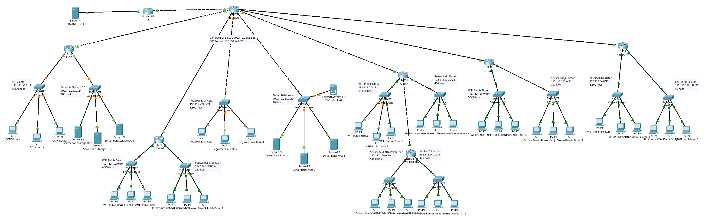
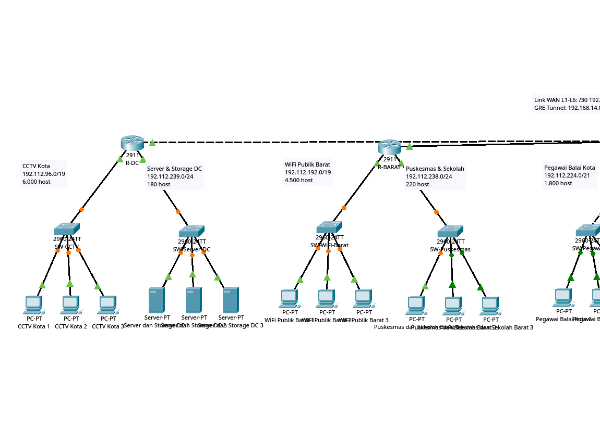
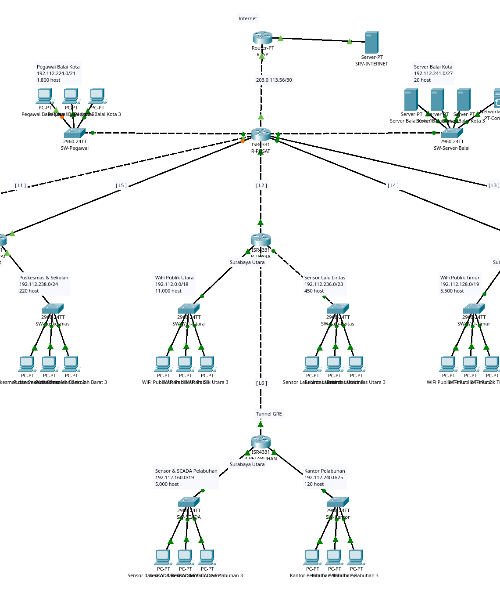
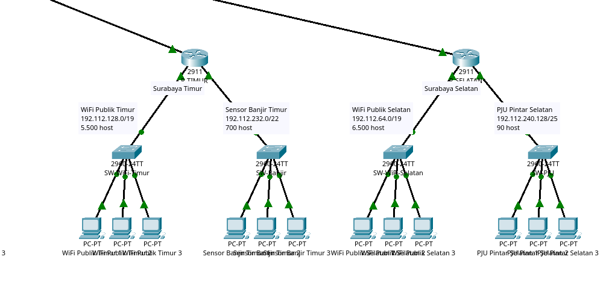

# MID PROJECT KOMUNIKASI DATA & JARINGAN KOMPUTER K14-012-066-082
### Implementasi Jaringan Smart City Pemerintah Kota Surabaya
Semester Gasal 2026/2027

---

## Anggota Kelompok 14

| No | Nama | NRP |
|:--:|:---|:---:|
| 1 | Fiorellin Ilona | 5027251082 |
| 2 | Gede Satya Putra Aryanta | 5027251012 |
| 3 | Catur Setyo Ragil | 5027251066 |

---

## Struktur Repositori

```text
.
├── images/
│   └── soal-8/                         Screenshot topologi & detail
├── nodes/
│   ├── R-ISP/
│   │   └── setup_isp.cfg               Konfigurasi R-ISP & Server 8.8.8.8
│   ├── R-PELABUHAN/
│   │   └── gre_tunnel.cfg              Konfigurasi GRE Tunnel & IPsec R-PELABUHAN
│   ├── R-PUSAT/
│   │   ├── gre_tunnel.cfg              Konfigurasi GRE Tunnel & IPsec R-PUSAT
│   │   └── static_nat.cfg              Konfigurasi Static Routing & NAT Overload
│   ├── dhcp_all_routers.cfg            Script DHCP 7 router + relay CCTV
│   ├── ospf_all_routers.cfg            Script OSPF 7 router + link L7
│   └── router_cabang_static.cfg        Script static route router cabang
├── K14_VLSM.pkt                        Topologi utama (static + GRE + NAT + aplikasi)
├── K14_VLSM_OSPF.pkt                   Varian dinamis (OSPF Area 0 + link cadangan L7)
├── UTS-KOMDAT-JARKOM-K14.xlsx          Spreadsheet subnetting resmi
├── .gitignore
└── README.md
```

---

## 1. Skema Pengalamatan

Skema yang dipakai adalah **VLSM** dengan blok induk `192.112.0.0/16`.

- Kebutuhan host LAN: **42.080 alamat**.
- Alokasi VLSM di blok `/16`: **61.752 alamat** pada `K14_VLSM.pkt` (tanpa L7) dan **61.756 alamat** pada `K14_VLSM_OSPF.pkt` (dengan L7 cadangan), termasuk network/broadcast; kapasitas `/16` 65.536 alamat, efisiensi 94,23%, sisa 3.784/3.780 alamat.
- CIDR mengalokasikan **118.784 alamat** pada blok induk `/15` berkapasitas 131.072 alamat (90,63% terpakai, sisa 12.288); hanya 42.080 alamat yang dipakai host (32,10% utilisasi), sehingga CIDR memakai sekitar 1,92x alokasi VLSM LAN dan 2,82x kebutuhan host.

### 1.1 Alokasi Subnet LAN (14 subnet)

| No | Router | Wilayah / Layanan | Kebutuhan Host | Network ID & Prefix | Gateway | Rentang Host | Broadcast |
|:--:|:---|:---|:---:|:---:|:---:|:---:|:---:|
| 1 | `R-UTARA` | WiFi Publik Utara | 11.000 | `192.112.0.0/18` | `192.112.0.1` | `.0.2` - `.63.254` | `192.112.63.255` |
| 2 | `R-SELATAN` | WiFi Publik Selatan | 6.500 | `192.112.64.0/19` | `192.112.64.1` | `.64.2` - `.95.254` | `192.112.95.255` |
| 3 | `R-DC` | CCTV Kota | 6.000 | `192.112.96.0/19` | `192.112.96.1` | `.96.2` - `.127.254` | `192.112.127.255` |
| 4 | `R-TIMUR` | WiFi Publik Timur | 5.500 | `192.112.128.0/19` | `192.112.128.1` | `.128.2` - `.159.254` | `192.112.159.255` |
| 5 | `R-PELABUHAN` | Sensor & SCADA Pelabuhan | 5.000 | `192.112.160.0/19` | `192.112.160.1` | `.160.2` - `.191.254` | `192.112.191.255` |
| 6 | `R-BARAT` | WiFi Publik Barat | 4.500 | `192.112.192.0/19` | `192.112.192.1` | `.192.2` - `.223.254` | `192.112.223.255` |
| 7 | `R-PUSAT` | Pegawai Balai Kota | 1.800 | `192.112.224.0/21` | `192.112.224.1` | `.224.2` - `.231.254` | `192.112.231.255` |
| 8 | `R-TIMUR` | Sensor Banjir Timur | 700 | `192.112.232.0/22` | `192.112.232.1` | `.232.2` - `.235.254` | `192.112.235.255` |
| 9 | `R-UTARA` | Sensor Lalu Lintas | 450 | `192.112.236.0/23` | `192.112.236.1` | `.236.2` - `.237.254` | `192.112.237.255` |
| 10 | `R-BARAT` | Puskesmas & Sekolah | 220 | `192.112.238.0/24` | `192.112.238.1` | `.238.2` - `.238.254` | `192.112.238.255` |
| 11 | `R-DC` | Server & Storage DC | 180 | `192.112.239.0/24` | `192.112.239.1` | `.239.2` - `.239.254` | `192.112.239.255` |
| 12 | `R-PELABUHAN` | Kantor Pelabuhan | 120 | `192.112.240.0/25` | `192.112.240.1` | `.240.2` - `.240.126` | `192.112.240.127` |
| 13 | `R-SELATAN` | PJU Pintar Selatan | 90 | `192.112.240.128/25` | `192.112.240.129` | `.240.130` - `.240.254` | `192.112.240.255` |
| 14 | `R-PUSAT` | Server Balai Kota | 20 | `192.112.241.0/27` | `192.112.241.1` | `.241.2` - `.241.30` | `192.112.241.31` |

### 1.2 Link Point-to-Point

| Link | Segmen | Subnet | Sisi A | Sisi B | Keterangan |
|:---:|:---|:---:|:---:|:---:|:---|
| `L1` | `R-PUSAT` - `R-DC` | `192.112.241.32/30` | `192.112.241.33` | `192.112.241.34` | Backbone Data Center |
| `L2` | `R-PUSAT` - `R-UTARA` | `192.112.241.36/30` | `192.112.241.37` | `192.112.241.38` | Backbone Utara |
| `L3` | `R-PUSAT` - `R-SELATAN` | `192.112.241.40/30` | `192.112.241.41` | `192.112.241.42` | Backbone Selatan |
| `L4` | `R-PUSAT` - `R-TIMUR` | `192.112.241.44/30` | `192.112.241.45` | `192.112.241.46` | Backbone Timur (via VLAN 40, `SW-Pegawai`) |
| `L5` | `R-PUSAT` - `R-BARAT` | `192.112.241.48/30` | `192.112.241.49` | `192.112.241.50` | Backbone Barat |
| `L6` | `R-UTARA` - `R-PELABUHAN` | `192.112.241.52/30` | `192.112.241.53` | `192.112.241.54` | Transit Pelabuhan |
| `L7` | `R-DC` - `R-UTARA` | `192.112.241.60/30` | `192.112.241.61` | `192.112.241.62` | Cadangan (file varian OSPF) |
| Uplink ISP | `R-PUSAT` - `R-ISP` | `203.0.113.56/30` | `203.0.113.57` | `203.0.113.58` | Akses internet |
| Internet | `R-ISP` - `SRV-INTERNET` | `8.8.8.0/24` | `8.8.8.1` | `8.8.8.8` | Simulasi internet |
| GRE Tunnel | `R-PUSAT` - `R-PELABUHAN` | `192.168.14.0/30` | `192.168.14.1` | `192.168.14.2` | Jalur privat Balai Kota - Pelabuhan |

---

## 2. Topologi Jaringan

Arsitektur jaringan mengusung model *hub-and-spoke* hierarkis simetris dengan `R-PUSAT` sebagai *core hub* kota.
Tata letak topologi pada canvas Cisco Packet Tracer telah disesuaikan secara presisi mengikuti bagan resmi (**Gambar 1. Topologi Mid-Project**):
- **Tingkat Atas**: `R-ISP` (*Internet*) berada di puncak tengah dan terhubung langsung ke Server Publik `8.8.8.8` di sebelah kanannya.
- **Tingkat Pusat (Core)**: `R-PUSAT` (*Balai Kota*) berada tepat di bawah `R-ISP`, diapit secara horizontal oleh LAN Pegawai Balai Kota di sisi kiri dan LAN Server Balai Kota di sisi kanan.
- **Tingkat Wilayah (5 Cabang Sejajar)**: Lima router regional disusun berjajar dalam satu garis horizontal rapi dari kiri ke kanan: `R-DC` (*Command Center*), `R-BARAT` (*Surabaya Barat*), `R-UTARA` (*Surabaya Utara*), `R-TIMUR` (*Surabaya Timur*), dan `R-SELATAN` (*Surabaya Selatan*).
- **Tingkat Distribusi LAN Wilayah**: Masing-masing router cabang menaungi 2 kelompok LAN (switch dan end-devices) yang tersusun rapi di bawahnya.
- **Tingkat Maritim (Pelabuhan)**: `R-PELABUHAN` diletakkan tepat vertikal di bawah `R-UTARA` terhubung via link fisik `L6` dan jalur virtual `Tunnel GRE`, membawahi LAN SCADA Pelabuhan dan Kantor Pelabuhan.
- Pada varian OSPF (`K14_VLSM_OSPF.pkt`), ditambahkan link cadangan `L7` antara `R-DC` dan `R-UTARA`.



Label pada canvas memuat identitas nama subnet, Network ID/prefix, kapasitas host, penanda link WAN (`L1` - `L6`), label `Tunnel GRE`, serta penanda uplink ISP `203.0.113.56/30`.

---

## 3. Penjelasan Teknis Solusi Per-Soal (Soal 1 s.d. Soal 8)

Berikut ringkasan implementasi teknis dan pemenuhan kriteria untuk seluruh butir penugasan Mid-Project:

### 3.1 Soal 1 — Skema Pengalamatan (Subnetting VLSM & Analisis CIDR)
- **Ketentuan**: Merancang pengalamatan berbasis blok induk `192.112.0.0/16` untuk 14 subnet LAN (kebutuhan 42.080 host) dan link WAN point-to-point (`/30`).
- **Implementasi VLSM**: Alokasi dilakukan bertingkat mulai dari kebutuhan host terbesar: WiFi Publik Utara (11.000 host, `/18`), WiFi Publik Selatan (6.500 host, `/19`), CCTV Kota (6.000 host, `/19`), hingga terkecil Server Balai Kota (20 host, `/27`), lalu dilanjutkan link point-to-point `L1` - `L6` (`/30`) dan cadangan `L7` (`/30`).
- **Analisis Efisiensi vs CIDR**:
  - **VLSM** mengalokasikan **61.752 alamat** pada blok `/16` (kapasitas 65.536), menghasilkan efisiensi tinggi **94,23%** dengan sisa 3.784 alamat yang dapat dialokasikan di masa depan.
  - **CIDR** membutuhkan blok induk `/15` (131.072 alamat) dan mengalokasikan **118.784 alamat**, padahal kebutuhan riil hanya 42.080 host (utilisasi riil hanya 32,10%). CIDR memboroskan sekitar 1,92x alamat dibanding VLSM.
- **Artefak**: Spreadsheet resmi [`UTS-KOMDAT-JARKOM-K14.xlsx`](UTS-KOMDAT-JARKOM-K14.xlsx).


### 3.2 Soal 2 — Desain Topologi & Penataan Perangkat Jaringan (CPT)
- **Ketentuan**: Membangun topologi modular skala kota di Cisco Packet Tracer dengan 8 Router, 14 Switch 2960, 36 PC host, 7 Server, dan 1 Network Controller.
- **Implementasi**: Penataan canvas dirancang simetris dan terstruktur sesuai Gambar 1 Soal:
  - Hubungan WAN point-to-point: `R-PUSAT` terhubung ke `R-DC` (`L1`), `R-UTARA` (`L2`), `R-SELATAN` (`L3`), `R-TIMUR` (`L4`), `R-BARAT` (`L5`), dan uplink `R-ISP`. `R-PELABUHAN` terhubung transit ke `R-UTARA` (`L6`).
  - Seluruh perangkat switch dan klien ditata rapi di bawah router masing-masing tanpa ada kabel yang saling tumpang-tindih (*clean cabling*).
- **Artefak**: [`K14_VLSM.pkt`](K14_VLSM.pkt) dan [`K14_VLSM_OSPF.pkt`](K14_VLSM_OSPF.pkt).

  


### 3.3 Soal 3 — Routing Statis Antar-Wilayah & Jalur Keluar ISP
- **Ketentuan**: Mengatur aliran paket antar-wilayah dan default route keluar kota menggunakan tabel rute statis yang efisien.
- **Implementasi**:
  - **Router Cabang**: Bertindak sebagai *stub network*, hanya membutuhkan satu rute default `ip route 0.0.0.0 0.0.0.0 <IP_WAN_R-PUSAT>`.
  - **R-PUSAT**: Menyimpan rute statis spesifik ke setiap LAN cabang melalui IP next-hop masing-masing, rute default `0.0.0.0/0` via uplink ISP `203.0.113.58`, serta rute ke LAN Pelabuhan diarahkan masuk ke `Tunnel0`.
  - **R-ISP**: Tidak memiliki rute balik ke blok privat `192.112.0.0/16` untuk menguji keabsahan mekanisme NAT.
- **Artefak**: [`nodes/router_cabang_static.cfg`](nodes/router_cabang_static.cfg) dan [`nodes/R-PUSAT/static_nat.cfg`](nodes/R-PUSAT/static_nat.cfg).

  

  


### 3.4 Soal 4 — Layanan Alokasi IP Dinamis (DHCP Services & Relay Terpusat)
- **Ketentuan**: 36 PC pengguna di 12 LAN menerima IP dinamis, gateway, dan DNS otomatis; router dan server ber-IP statis; subnet CCTV Kota dilayani DHCP server Data Center (bukan oleh router).
- **Implementasi**:
  - Dibuat pool DHCP di 7 router cabang/pusat dengan exclusion address `.1 - .20` guna memproteksi IP gateway dan perangkat infrastruktur statis.
  - Setiap pool otomatis menyertakan `dns-server 192.112.239.2` (Server DNS Data Center).
  - **DHCP Relay CCTV**: Pada antarmuka `GigabitEthernet0/1` `R-DC`, diaktifkan `ip helper-address 192.112.239.2`. Broadcast DHCP Discover dari PC CCTV diubah menjadi unicast menuju `Server dan Storage DC 1` (pool `CCTV-KOTA` rentang `192.112.96.100` - `.119.211`). `R-DC` sama sekali tidak memiliki pool lokal untuk CCTV.
- **Artefak**: [`nodes/dhcp_all_routers.cfg`](nodes/dhcp_all_routers.cfg) dan topologi live [`K14_VLSM.pkt`](K14_VLSM.pkt).


### 3.5 Soal 5 — Akses Internet & NAT Overload / PAT
- **Ketentuan**: Memungkinkan seluruh perangkat LAN privat mengakses server internet publik `8.8.8.8` tanpa membocorkan alamat privat ke ISP.
- **Implementasi**:
  - NAT Overload (PAT) diterapkan di `R-PUSAT` pada interface uplink `GigabitEthernet0/0/2` (`ip nat outside`).
  - Seluruh interface LAN internal dan subinterface/SVI ditandai sebagai `ip nat inside`.
  - Digunakan `access-list 1 permit 192.112.0.0 0.0.255.255` dan `permit 192.168.14.0 0.0.0.3` yang diikat dengan perintah `ip nat inside source list 1 interface GigabitEthernet0/0/2 overload`.
  - Trafik ribuan host internal ditranslasikan menjadi IP publik tunggal `203.0.113.57` dengan port multiplexing.
- **Artefak**: [`nodes/R-PUSAT/static_nat.cfg`](nodes/R-PUSAT/static_nat.cfg).

  

### 3.6 Soal 6 — Jalur Privat Virtual Terenkripsi (GRE Tunnel & Keamanan IPsec)
- **Ketentuan**: Membangun tunnel privat Balai Kota - Pelabuhan menembus `R-UTARA`, menganalisis alasan router memilih tunnel, menganalisis kelemahan GRE, dan menerapkan proteksi enkripsi IPsec.
- **Implementasi**:
  - **GRE Tunnel**: Konfigurasi antarmuka `Tunnel0` (`192.168.14.0/30`) pada `R-PUSAT` (`192.168.14.1`) dan `R-PELABUHAN` (`192.168.14.2`), dengan MTU 1476.
  - **Pemilihan Jalur**: Router memilih tunnel karena rute ke LAN Pelabuhan memiliki *Longest Prefix Match* (`/19` dan `/25`) yang lebih spesifik dibanding default route (`/0`), serta memiliki *Administrative Distance* statis (AD 1) yang mengungguli rute OSPF (AD 110).
  - **Kelemahan GRE**: GRE hanya protokol enkapsulasi (IP proto 47) tanpa enkripsi, sehingga payload teks mentah rentan disadap di router transit `R-UTARA`.
  - **IPsec over GRE**: Diterapkan ISAKMP Policy 10 (AES-128, SHA-1, DH Group 2, PSK `K14SECURE`) dan Transform-set ESP-AES ESP-SHA. Crypto Map `CMAP` dipasang pada port fisik WAN `R-PUSAT` (`Gi0/0/1`) dan `R-PELABUHAN` (`Gi0/0/0`). Status SA terverifikasi `ACTIVE` dengan pertambahan counter enkapsulasi/dekapsulasi.
- **Artefak**: [`nodes/R-PUSAT/gre_tunnel.cfg`](nodes/R-PUSAT/gre_tunnel.cfg) dan [`nodes/R-PELABUHAN/gre_tunnel.cfg`](nodes/R-PELABUHAN/gre_tunnel.cfg).


### 3.7 Soal 7 — Dynamic Routing OSPF Area 0 & Redundansi Link L7 (Failover)
- **Ketentuan**: Pada file varian `K14_VLSM_OSPF.pkt`, mengganti seluruh static routing antar-router dengan OSPFv2 Single Area 0, Router-ID terstruktur, tanpa pesan OSPF ke arah LAN pengguna, serta uji ketahanan link cadangan L7 (`R-DC` <--> `R-UTARA`).
- **Implementasi**:
  - Protokol OSPF aktif pada ketujuh router kota dalam **Backbone Area 0** (`network 192.112.0.0 0.0.255.255 area 0`).
  - **Router-ID**: Dikonfigurasi eksplisit `1.1.1.1` (`R-PUSAT`) hingga `7.7.7.7` (`R-PELABUHAN`).
  - **Default Route Injection**: Perintah `default-information originate` dipasang di `R-PUSAT`, menyebarkan rute default `O*E2` secara otomatis ke seluruh cabang.
  - **Keamanan LAN**: `passive-interface` dipasang di seluruh antarmuka LAN pengguna (`Vlan21`/`Vlan27` di R-PUSAT, `Vlan23`/`Gi0/0/2` di R-UTARA, `Gi0/1`/`Gi0/2` di cabang lain) untuk mencegah *rogue neighbor* dan menghemat CPU/bandwidth.
  - **Link Cadangan L7 & Uji Failover**: Subnet WAN `/30` dialokasikan pada `192.112.241.60/30` di atas SVI Vlan1 HWIC-4ESW. Saat link utama `L1` diputus (*shutdown*), OSPF langsung mengalihkan rute Data Center melalui `R-UTARA` dan `L7` dalam hitungan detik (*zero packet loss* setelah konvergensi).
- **Artefak**: [`nodes/ospf_all_routers.cfg`](nodes/ospf_all_routers.cfg) dan [`K14_VLSM_OSPF.pkt`](K14_VLSM_OSPF.pkt).


### 3.8 Soal 8 — Layanan Aplikasi Smart City Terpusat
- **Ketentuan**: Mengimplementasikan 4 layanan aplikasi inti (DNS, Web, FTP, Mail) pada domain internal `14.smartcity.lab` dan alias `surabaya.go.id`.
- **Implementasi**:
  1. **DNS Server** (`Server dan Storage DC 1` - `192.112.239.2`): Menyediakan *Forward Lookup Zone* untuk `14.smartcity.lab` dan `surabaya.go.id` (A record untuk apex, `www`, `ftp`, dan `mail`).
  2. **Web Server** (`Server Balai Kota 1` - `192.112.241.2`): Menampilkan portal resmi "Portal Smart City Surabaya" lengkap dengan identitas kelompok 14.
  3. **FTP Server** (`Server dan Storage DC 2` - `192.112.239.3`): Menampung backup CCTV (`user: cctv / pass: K14cctv`) dan berkas staf (`user: pegawai / pass: K14pegawai`) dengan hak akses penuh RWDNL.
  4. **Mail Server** (`Server dan Storage DC 3` - `192.112.239.4`): Melayani SMTP dan POP3 domain `14.smartcity.lab` untuk akun staf Balai Kota (`balai1` - `balai3`) dan Pelabuhan (`pelabuhan1` - `pelabuhan3`), teruji berkirim email dua arah.
- **Artefak**: Layanan server terkonfigurasi aktif di [`K14_VLSM.pkt`](K14_VLSM.pkt) (`Server Balai Kota 1` dan `Server dan Storage DC 1-3`).


---

## 4. Dokumentasi Visual

Screenshot dokumentasi diambil langsung dari canvas Cisco Packet Tracer dengan penataan tata letak simetris terbaru.

### 4.1 Wilayah Barat dan Data Center

Menampilkan router `R-DC` (*Command Center*) dan `R-BARAT` (*Surabaya Barat*) beserta 4 LAN pengguna: CCTV Kota, Server & Storage DC, WiFi Publik Barat, dan Puskesmas & Sekolah Barat.



### 4.2 Balai Kota, Utara, dan Pelabuhan

Menampilkan tulang punggung utama kota: `R-ISP`, `R-PUSAT` (*Balai Kota*) beserta LAN Pegawai dan Server Balai Kota, `R-UTARA` (*Surabaya Utara*) dengan sensor lalu lintas dan WiFi utara, serta `R-PELABUHAN` dengan SCADA dan Kantor Pelabuhan yang terhubung melalui GRE Tunnel.



### 4.3 Timur dan Selatan

Menampilkan router `R-TIMUR` (*Surabaya Timur*) dengan WiFi Publik Timur dan Sensor Banjir, serta `R-SELATAN` (*Surabaya Selatan*) dengan WiFi Publik Selatan dan PJU Pintar.



---

## 5. Bukti Pengujian

**DHCP pada klien CCTV (CCTV Kota 1, relay ke server DC):**

```text
IPv4 Address........: 192.112.96.100
Subnet Mask.........: 255.255.224.0
Default Gateway.....: 192.112.96.1
DHCP Server.........: 192.112.239.2
DNS Servers.........: 192.112.239.2
```

**Lease klien CCTV (dari `ipconfig /all`):**

```text
Klien CCTV — pool CCTV-KOTA
192.112.96.100  00E0.B0AB.9413  (CCTV Kota 1)
192.112.96.101  0005.5EB1.14A0  (CCTV Kota 2)
192.112.96.102  0005.5EC8.A0CA  (CCTV Kota 3)
```

**Resolusi DNS dari wilayah lain:**

```text
C:\> nslookup www.14.smartcity.lab
Server:  [192.112.239.2]
Name:    www.14.smartcity.lab
Address: 192.112.241.2
```

**Akses web dari wilayah Selatan, Utara, Pelabuhan, dan Timur:**

```text
Portal Smart City Surabaya
Pemerintah Kota Surabaya
Kelompok 14
Fiorellin Ilona - 5027251082
Gede Satya Putra Aryanta - 5027251012
Catur Setyo Ragil - 5027251066
```

**Login FTP dari LAN CCTV Kota:**

```text
C:\> ftp ftp.14.smartcity.lab
Username: cctv
Password: *******
230- Logged in
ftp> dir
Listing /ftp directory from ftp.14.smartcity.lab
```

**Routing dan internet:**

```text
R-TIMUR# show ip ospf neighbor
1.1.1.1        1   FULL/BDR  00:00:32   192.112.241.45   GigabitEthernet0/0

C:\> ping 8.8.8.8
Reply from 8.8.8.8: bytes=32 time<1ms TTL=125
```

